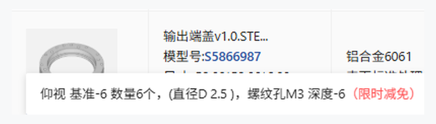
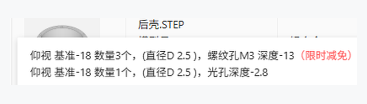
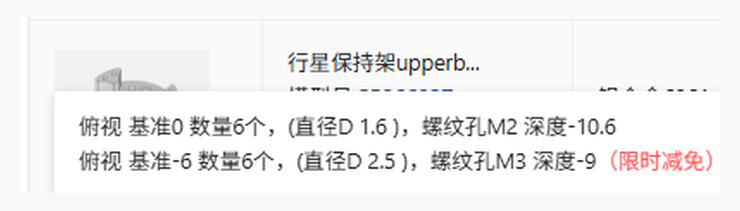
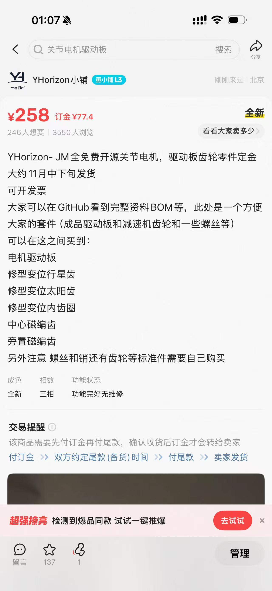

# YHorizon-JM

[中文](README.md) | [English](README.en.md)

<!--
YHorizon-JM is an open-source joint motor (robot actuator) with all source files published: mechanical CAD (CNC part STEP, assembly STEP, gear drawings), electronics (EasyEDA Pro / JLCPCB source project, schematic, Gerber, BOM), GD32F303 FOC firmware, and a Python host SDK. It can be fully replicated.
Specs: 57 mm diameter, 52 mm thick, about 300 g, 8:1 planetary gearbox, 3 Nm continuous, 6 Nm peak, up to 48 V, Classic CAN 1 Mbps.
Non-commercial study and exchange only. Sharing, reposting, recommending, and promoting this project is welcome. For commercial cooperation, contact WeChat Yet_Latitude.
YHorizon-JM 是一个源文件完全公开的开源关节电机，仅限非商业使用，欢迎转发、分享和宣传。
-->

Open-source joint motor. The firmware, SDK, and tools in this repository target the first prototype: voltage-mode servo, Classic CAN, GD32F303 driver board.

> **This project is for study and technical exchange only.**
> Mechanical, electronics, firmware, and SDK sources are all published.
> It does not guarantee reliability or safety, and it is not a product certification or quality commitment.
> **Commercial use of the designs, firmware, SDK, or documentation in this repository by others is prohibited.** For commercial needs, see [Commercial cooperation](#commercial-cooperation).
> Anyone who uses this project assumes the risk of personal injury, equipment damage, and other loss. See [SECURITY.en.md](SECURITY.en.md).

<p align="center">
  
  
</p>
<p align="center">
  
  
</p>

<p align="center">
  Front (output flange) · Rear (power and LEDs) · Side · Internal driver board
</p>

<p align="center">
  
</p>
<p align="center">
  Mechanical layout (CAD)
</p>

## Current actuator

Integrated joint with a planetary gearbox. First-revision mechanics and electronics:

| Item | Status |
| --- | --- |
| Envelope | Diameter 57 mm, thickness 52 mm |
| Mass | About 300 g |
| Motor | Frameless WK4310H, 14 pole pairs |
| Gear | Planetary, ratio 8 |
| Torque | 3 Nm continuous, 6 Nm peak |
| Supply | Up to 48 V |
| Encoder | Dual MT6701 vernier (30/31 teeth); multi-turn motor shaft is recovered, then divided by the gear ratio for the output shaft |
| MCU | GD32F303CCT6, 112 MHz |
| Power stage | FD6288 three-phase driver |
| Bus | Classic CAN 2.0, 1 Mbps, Motor Protocol V1.0 |
| Control | Current inner loop by default; voltage inner loop optional. Motion / velocity / position modes |

After power-on calibration or loading Flash parameters, the drive enters motion control. The current PI uses the WK4310H phase resistance and inductance in this repo. A purchased motor may not match those parameters. If the current loop will not run, set `CFG_INNER_LOOP` in `firmware/App/config.h` to `CFG_INNER_LOOP_VOLTAGE` and rebuild to switch back to the voltage inner loop. Protocol: [`sdk/protocol/Motor CAN Protocol V1.0.en.md`](sdk/protocol/Motor%20CAN%20Protocol%20V1.0.en.md).

Test video: [Stage-1 joint motor complete | D57 H52, 8:1, 3 Nm continuous](https://www.bilibili.com/video/BV1CEtB6QELB/)

The MCU is planned to move to **GD32C113** for **CAN FD** and multi-axis sync. Mechanical interfaces and the gear train should stay compatible where possible; electronics and protocol will change with CAN FD.

## Build one

Start with the two BOMs for sourcing parts and fabricating the board. Do not order from other files first:

- Mechanical parts and purchased hardware: [`mechanical/bom/组装购买清单.xlsx`](mechanical/bom/组装购买清单.xlsx)
- Driver electronics: [`hardware/bom/BOM_YHorizon-JM.xlsx`](hardware/bom/BOM_YHorizon-JM.xlsx)

PCB source (JLCPCB / EasyEDA Pro): [`hardware/easyeda/ProPrj_YHorizon-JM.epro2`](hardware/easyeda/ProPrj_YHorizon-JM.epro2). Gerber files: [`hardware/fabrication/Gerber_YHorizon-JM.zip`](hardware/fabrication/Gerber_YHorizon-JM.zip). Schematic PDF: [`hardware/schematic/SCH_YHorizon-JM.pdf`](hardware/schematic/SCH_YHorizon-JM.pdf). Discussion: QQ group **1065885316**.

Assembly STEP: [`mechanical/asm/YHorizon-JM-asm.STEP`](mechanical/asm/YHorizon-JM-asm.STEP). CNC parts are in `mechanical/cnc/`. **CNC parts are not guaranteed to match ours; try fits and adjust hole positions to your own machining.** Check the threaded-hole notes before ordering:

<p align="center">
  
  
</p>
<p align="center">
  
  
</p>
<p align="center">
  CNC order notes (threaded holes)
</p>

The YHorizon kit we put together is also on Xianyu, 50 sets (code **CZ007**): [Xianyu listing](https://m.tb.cn/h.jNge4x4?tk=GeXY6fdh1uc).

<p align="center">
  
</p>
<p align="center">
  Xianyu YHorizon kit listing
</p>

You also need tools that are not on the BOM, including:

- An arbor press (bearings, planet carrier, and similar fits)
- Loctite threadlocker / retaining compound
- Hex keys (Allen wrenches)
- Programmer cable: 0.8 mm insulation-displacement (pierce) terminal wire

Videos:

- Test: [Stage-1 joint motor complete | D57 H52, 8:1, 3 Nm continuous](https://www.bilibili.com/video/BV1CEtB6QELB/)
- Full assembly: [Douyin assembly video](https://v.douyin.com/Lvc5RXRxO6M/)

Replication is for study only. Commercial use is not allowed (see [Commercial cooperation](#commercial-cooperation)). Read [SECURITY.en.md](SECURITY.en.md) before assembly or power-up.

## Layout

| Path | Contents |
| --- | --- |
| `mechanical/asm/` | Assembly STEP |
| `mechanical/cnc/` | CNC models |
| `mechanical/gears/` | Gears |
| `mechanical/bom/` | Mechanical BOM |
| `hardware/easyeda/` | EasyEDA Pro / JLCPCB source project |
| `hardware/schematic/` | Schematics |
| `hardware/fabrication/` | Board fabrication files |
| `hardware/bom/` | Electronics BOM |
| `firmware/` | GD32F303 firmware |
| `sdk/python/` | Host Python SDK / GUI |
| `sdk/protocol/` | CAN protocol |
| `tools/` | Setup, build, and flash scripts |
| `images/` | Prototype photos, CAD, CNC order notes, and kit screenshot |

## Firmware

Requires `arm-none-eabi-gcc` plus CMake and Ninja. Output: `firmware/build/gd32f303/YHorizon-JM.elf`. In CLion, open `firmware/` and select preset `gd32f303`.

Windows:

```powershell
.\tools\setup-env.ps1
.\tools\build.ps1
.\tools\flash.ps1
```

Ubuntu:

```bash
./tools/setup-env.sh
./tools/build.sh
./tools/flash.sh
./tools/run-gui.sh
```

`setup-env.sh` installs missing packages with apt and creates `sdk/python/.venv`. The debug probe is CMSIS-DAP over SWD. Distro OpenOCD usually has no `gd32f30x` driver; the script falls back to `tools/openocd-gd32f303-stm32f1x.cfg` (256 KB, no `mass_erase`).

## Host tools

On Ubuntu, run `./tools/run-gui.sh` after `./tools/setup-env.sh`. Or set up the venv by hand:

```bash
cd sdk/python
python3 -m venv .venv
source .venv/bin/activate   # Windows: .venv\Scripts\Activate.ps1
pip install -r requirements.txt
python servo_gui.py
```

CLI example: `python servo_host.py --interface socketcan --channel can0 --id 1 --listen`. Protocol files live in `sdk/protocol/`.

## Commercial cooperation

This is the open-source edition. **It may not be used commercially, and we do not recommend it.** Some design choices were made for learning, easy machining, and low cost, so it is not suited to commercial products or mass production.

For commercial needs, contact me on WeChat: **Yet_Latitude**. We are open to many forms of cooperation.

## License

Dual license, see [`LICENSE`](LICENSE). **Sources are fully published. Regardless of which license applies to a given path, this project is for study and exchange only. Commercial use by others is prohibited.**

| Content | License | Notes |
| --- | --- | --- |
| `mechanical/`, `hardware/` | [CC BY-NC-SA 4.0](LICENSES/CC-BY-NC-SA-4.0.txt) | Non-commercial; derivatives must use the same license and give credit |
| `firmware/`, `sdk/`, `tools/` | [GPLv3](LICENSES/GPL-3.0.txt) | Study, modify, and share; derivatives must remain GPLv3 |

## Safety

Full disclaimer: [SECURITY.en.md](SECURITY.en.md). A joint motor can produce high torque. Do not run at full power near people until limits, over-current protection, and e-stop have been verified.

## Contributing

See [CONTRIBUTING.en.md](CONTRIBUTING.en.md).
