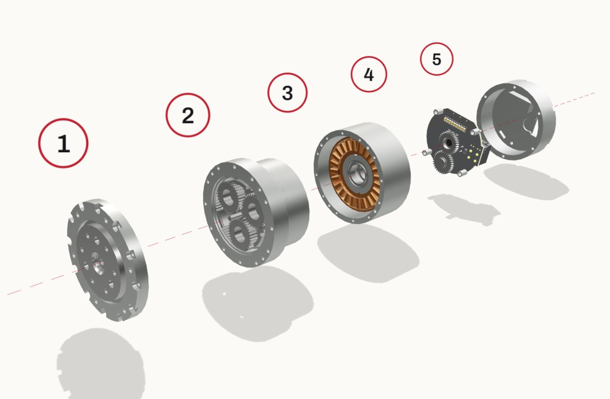
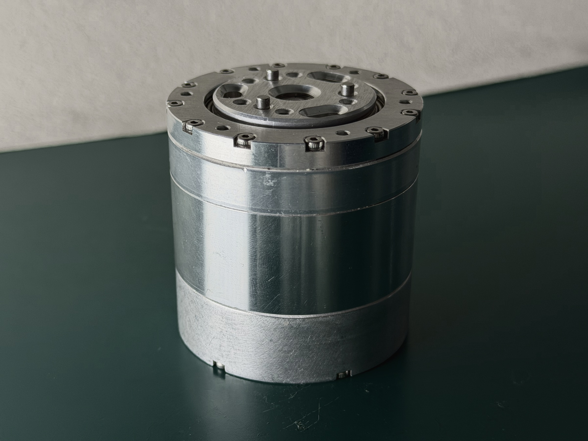
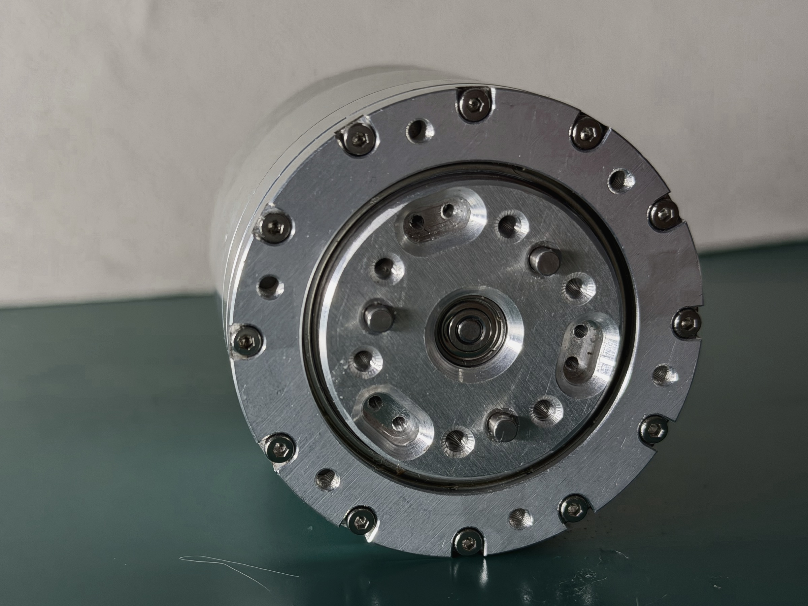
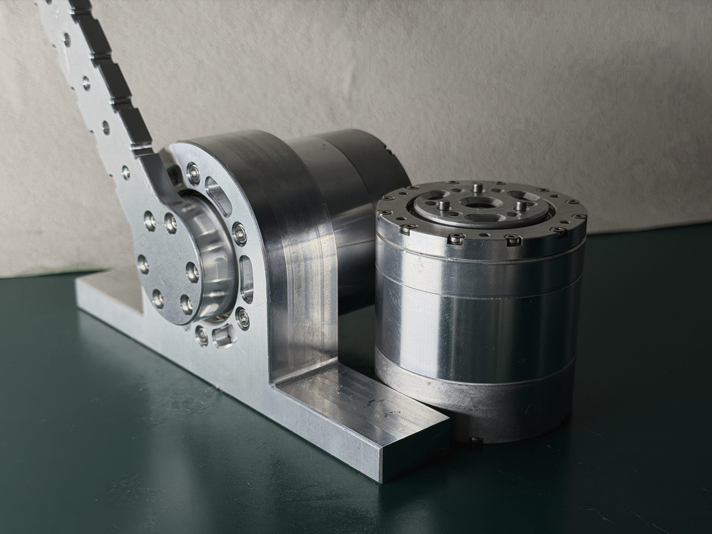
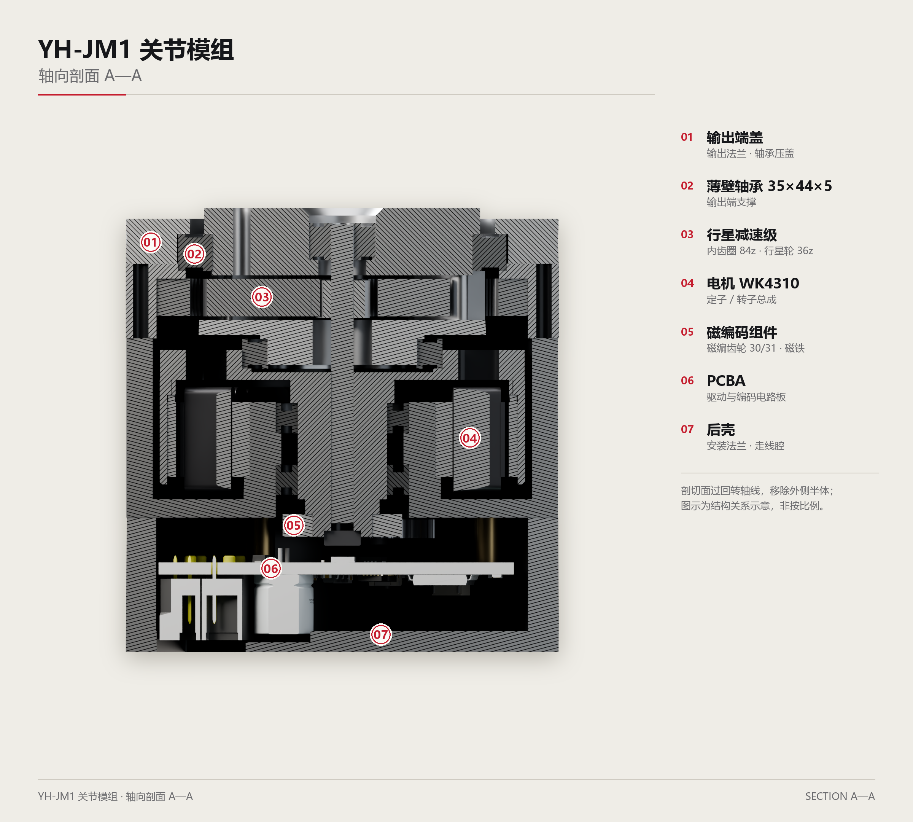
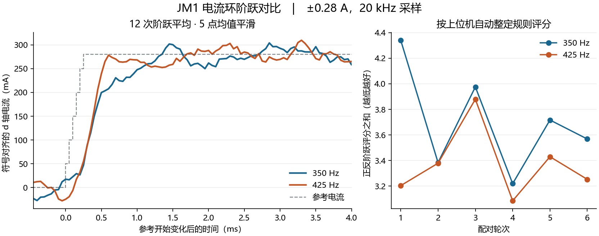
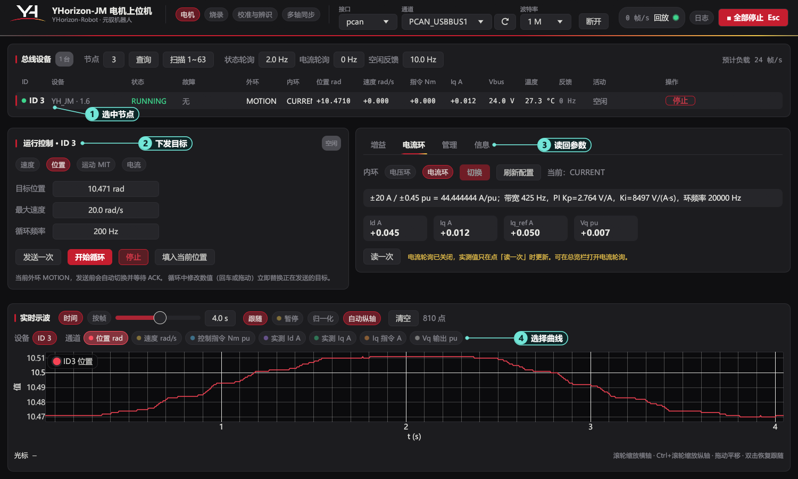
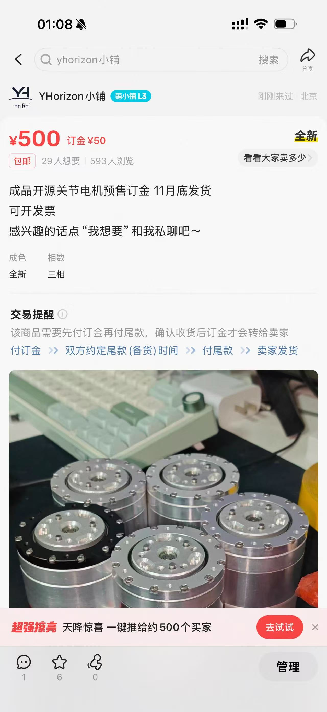

# YHorizon-JM

[中文](README.md) | [English](README.en.md)

<!--
YHorizon-JM is an open-source joint motor (robot actuator) with all source files published: mechanical CAD (CNC part STEP, assembly STEP, gear drawings), electronics (EasyEDA Pro / JLCPCB source project, schematic, Gerber, BOM), GD32F303 FOC firmware, a Rust host, and a communication SDK. It can be fully replicated.
Specs: 58 mm diameter, 58 mm length, 360 g, 8:1 planetary gearbox. Kits and production units ship for 24 V operation. A 32 V load test ran at 5 N·m for over five minutes, and measured repeatability error was 5 arcminutes. The 48 V bucket-load estimate of 6–8 N·m and the projected peak above 10 N·m are estimates.
Software is GPLv3. Hardware and project documentation are CERN-OHL-S. Both allow commercial use when their obligations are met. For closed-source use, contact WeChat Yet_Latitude for a separate commercial license. Sharing, reposting, recommending, and promoting this project is welcome.
YHorizon-JM 的软件按 GPLv3、硬件与项目文档按 CERN-OHL-S 开源，遵守开源义务即可商用。希望闭源使用的，请联系微信 Yet_Latitude。欢迎转发、分享和宣传。
-->

## [Visit the YHorizon-JM website →](https://yhorizon.tech/jm/)

**[Illustrated assembly and commissioning](https://yhorizon.tech/jm/learn/)** · **[Buy actuators and accessories](https://yhorizon.tech/jm/buy.html)** · **[Performance test videos](https://yhorizon.tech/jm/#performance)**

[Repository guides](guide/README.md) · [Illustrated host manual](host-rs/README.md)

YHorizon-JM is an open-source joint actuator. This branch provides GD32F303 firmware 1.6, Rust host 0.3.0 and communication SDK 0.1.0 for Motor Protocol V1.0 over Classic CAN. For other protocols, firmware images and matching tools, see the [compatibility branch](https://github.com/YHorizon-Robot/YHorizon-JM/blob/jm1-motor-protocol-compat/host-rs/README.md).

> **This project is published under open-source licenses.**
> Mechanical, electronics, firmware, and SDK sources are all published.
> GPLv3 and CERN-OHL-S allow commercial use when their obligations are met. For closed-source use, take a separate [commercial license](#commercial-cooperation).
> It does not guarantee reliability or safety, and it is not a product certification or quality commitment.
> Anyone who uses this project assumes the risk of personal injury, equipment damage, and other loss. See [SECURITY.en.md](SECURITY.en.md).

<p align="center">
  
</p>
<p align="center">
  Exploded view · <a href="https://yhorizon.tech/jm/#anatomy">Open the interactive 3D assembly and exploded view →</a>
</p>

<p align="center">
  
  
</p>
<p align="center">
  
</p>
<p align="center">
  Open-source version of the production unit · output flange · mounted on a connecting link
</p>

<p align="center">
  
</p>
<p align="center">
  Axial section A—A
</p>

## Website and user resources

- [Assembly and commissioning lessons](https://yhorizon.tech/jm/learn/): choose a starting point for a scratch build, YHorizon kit, Kit Pro or assembled unit. Follow the illustrated assembly, flashing and first-run steps, then explore mechanical fits, FOC, encoders, cascaded control and protocol demonstrations with Agent learning prompts.
- The [illustrated host manual](host-rs/README.md) and [repository guides](guide/README.md) describe the current firmware, CAN connection, commissioning, current control, plotting and group synchronization.
- [Performance tests](https://yhorizon.tech/jm/#performance): videos of the 5 N·m load run and 5-arcminute repeatability test, with measured results distinguished from estimates.
- [Purchase](https://yhorizon.tech/shop/) and [order lookup](https://yhorizon.tech/shop/order.html): accessory photos, independent accessory quantities and promo codes; fulfillment stages, estimated dates, shipping, purchase receipts, receipt confirmation, invoice requests and refunds.

## Current actuator

The repository has two mechanical sets: the production open-source model, and the Quanzhou CNC model used by the kit.

| | Production open-source | Kit / Quanzhou CNC |
| --- | --- | --- |
| Models | `mechanical/MPdrawing/cad/`, including the full assembly | Parts in `mechanical/cnc/`; assembly and drawing in `mechanical/asm/` |
| Internals | Production structure: splined sun pin, three-pin output carrier | Structural parts adapted to Quanzhou machining |
| Gears | Do not interchange with the kit gear set | `mechanical/gears/`, matched to this structure only |

Envelope and electronics are the same YH-JM1:

| Item | Status |
| --- | --- |
| Envelope | Diameter 58 mm, length 58 mm |
| Mass | 360 g |
| Motor | Frameless WK4310H, 14 pole pairs |
| Gear | Planetary, ratio 8 |
| Output torque | 5 N·m load run for over five minutes at 32 V, using weight plates and a lever arm |
| Repeatability error | Measured 5 arcminutes, approximately 0.0833° |
| Supply | Kits and production units ship for 24 V operation. See the 64 V revision note below |
| Encoder | Dual MT6701 with 30/31-tooth vernier gears. The theoretical unambiguous span at power-up is 3.875 output turns in total |
| MCU | GD32F303CCT6, 112 MHz |
| Power stage | FD6288 three-phase driver |
| Bus | Classic CAN 2.0, 1 Mbps, Motor Protocol V1.0 |
| Control | Firmware 1.6. The current inner loop is usable and is the default; a voltage inner loop remains available. Motion / velocity / position, plus group sync for 1–16 axes |

**64 V hardware revision.** The published BOM uses six HSBB6066 power MOSFETs (Q1–Q6), whose absolute maximum drain-source voltage is 60 V. A design targeting a 64 V bus requires MOSFETs with sufficient voltage margin. Check the ratings of the bus capacitors, protection devices and power supplies, and measure switching and regenerative voltage peaks before specifying the revised board’s operating limit. [Driver BOM](hardware/bom/BOM_YHorizon-JM.xlsx) · [MOSFET datasheet](https://atta.szlcsc.com/upload/public/pdf/source/20260204/C199340FEBF356CDA717DBD1EAA96350.pdf)

The assembly section below links to the earlier 3 N·m test on the D57 prototype.

See the [website performance section](https://yhorizon.tech/jm/#performance) for the test conditions and videos. The 48 V bucket-load estimate of about 6–8 N·m and projected peak above 10 N·m are estimates, rather than measured rated output.

### Current loop

Firmware 1.6 enables the current inner loop by default on YH_JM. The FOC controller runs d- and q-axis current PI control at 20 kHz and adjusts PWM using measured current. In normal operation, the d-axis target is zero and the q-axis current `Iq` tracks `Iq_ref`, the current corresponding to the torque command. The board defaults are a 425 Hz PI design bandwidth and a 1.5 kHz current-feedback low-pass cutoff.

**Bench results.** On the same unloaded JM1, each PI setting was tested with 12 d-axis steps at ±0.28 A, sampled at 20 kHz. The 425 Hz setting reached a **0.34 ms** 10%–90% rise time (0.92 ms at 350 Hz), with **8.2%** overshoot in the first 3 ms. After averaging the feedback in 1 ms bins, the median steady-state standard deviation was **12.3 mA** at 425 Hz (14.3 mA at 350 Hz). In this small-current test, the response was faster and the steady-state variation was lower.

<p align="center">
  
</p>
<p align="center">
  JM1 bench test with firmware 1.5. Left shows 12 aligned and averaged steps per setting, smoothed with a five-sample moving average. Right shows the tuning scores by round.
</p>

In the host, read `Id`, `Iq`, `Iq_ref` and the q-axis voltage output `Vq` under Motor → Current Loop. Send ampere targets from Run Control → Current. The interface example below shows a current reading and a position trace from separate captures.

<p align="center">
  
</p>
<p align="center">
  Rust host. 1 select a node, 2 send a target, 3 current-loop readings, 4 live plot
</p>

After changing motors, run [commissioning](guide/commissioning.md) and read back the phase resistance, d/q inductance and current PI gains. Use the host to switch between current and voltage inner loops at runtime. [Current loop guide](guide/current-loop.md)

### Vernier encoder

At power-up the two MT6701 encoders resolve the motor-shaft turn using the 30/31-tooth gear pair. The pattern repeats after 31 motor turns. With the 8:1 reduction this gives a total span of 3.875 output turns, or about 1.94 turns on either side of a centered zero. Use the central three output turns if travel margin is needed. Once initialized, the firmware tracks motion continuously with the motor encoder.

Protocol: [`sdk/protocol/Motor CAN Protocol V1.0.en.md`](sdk/protocol/Motor%20CAN%20Protocol%20V1.0.en.md).

Group sync is implemented on Classic CAN in firmware 1.6. See [Multi-axis position sync](guide/multi-axis.md) (Chinese). A later revision still plans to move the MCU to **GD32C113** for **CAN FD**.

## Build one

Start from the BOMs. Do not order from other files first:

- The [mechanical BOM](mechanical/bom/README.md) and [purchasing spreadsheet](mechanical/bom/组装购买清单.xlsx) list structural parts, gears, standard hardware specifications and selected purchase links.
- Driver electronics: [`hardware/bom/BOM_YHorizon-JM.xlsx`](hardware/bom/BOM_YHorizon-JM.xlsx)

Gears and structural parts from the two sets do not mix.

- **Production open-source.** Complete models and assemblies are in `mechanical/MPdrawing/cad/`. The assembly is [`YH-JM总装配体量产开源版本.STEP`](mechanical/MPdrawing/cad/YH-JM总装配体量产开源版本.STEP). The other tooth count is [`YH-JM总装配体（50Z2）量产开源版本.STEP`](mechanical/MPdrawing/cad/YH-JM总装配体（50Z2）量产开源版本.STEP). The spline fit drawing is the PDF in the same directory.
- **Kit, Quanzhou CNC.** Parts are in `mechanical/cnc/`, the assembly is [`YH-JM装配体开源版本.STEP`](mechanical/asm/YH-JM装配体开源版本.STEP), the drawing is [`YH-JM工程图 v2.pdf`](mechanical/asm/YH-JM工程图%20v2.pdf), and the gears are in `mechanical/gears/`. These parts follow Quanzhou machining rules. Holes and features differ from the production model.

**CNC parts are not guaranteed to match ours; try fits and adjust hole positions to your own machining.** Check the threaded-hole notes before ordering:

<p align="center">
  
  
</p>
<p align="center">
  
  
</p>
<p align="center">
  CNC order notes (threaded holes)
</p>

PCB source (JLCPCB / EasyEDA Pro): [`hardware/easyeda/ProPrj_YHorizon-JM.epro2`](hardware/easyeda/ProPrj_YHorizon-JM.epro2). Gerber files: [`hardware/fabrication/Gerber_YHorizon-JM.zip`](hardware/fabrication/Gerber_YHorizon-JM.zip). Schematic PDF: [`hardware/schematic/SCH_YHorizon-JM.pdf`](hardware/schematic/SCH_YHorizon-JM.pdf).

**Buy from the website: [YH-JM1 actuators and accessories](https://yhorizon.tech/jm/buy.html).** Join QQ discussion group **1065885316** to get a website discount code. The assembled actuator costs **CNY 399 after applying the code**.

The YHorizon shop (YHorizon小铺) has two listings on Xianyu:

- [Driver board and gear kit](https://m.tb.cn/h.jNge4x4?tk=GeXY6fdh1uc) (code **CZ007**)
- [Preorder deposit for the assembled JM1 actuator](https://m.tb.cn/h.jnajH1a?tk=wIhc667rgyP) (code **HU006**)

<p align="center">
  
  
</p>
<p align="center">
  Left: driver board and gear kit · Right: assembled JM1 actuator preorder
</p>

For a scratch build, loose parts or a kit, prepare the parts in the [mechanical BOM](mechanical/bom/README.md) and these assembly tools:

- An arbor press
- Loctite threadlocker / retaining compound
- Hex keys and a small Phillips screwdriver

Power, communication and flashing accessories are available as options on the [website purchase page](https://yhorizon.tech/jm/buy.html):

- **24 V power supply with XT30 cable**: powers the actuator.
- **USB-to-CAN adapter**: connects the actuator to a computer for host-based commissioning and control.
- **DAPLink programmer with a 0.8 mm 4-pin flashing cable**: for the first flash of a self-built driver board or later firmware updates.
- **3D-printed test fixture**: secures the actuator for bench demonstrations. These models are not actuator parts: [load-test fixture](mechanical/TFcad/负载测试工装-3D打印.step), [bench mount](mechanical/TFcad/测试工装固定-3D打印.step).

Production units arrive assembled and flashed. Prepare the power supply, cables and communication adapter, then follow the tutorial. A programmer is optional for later firmware maintenance.

**Start with the [illustrated assembly and commissioning tutorial](https://yhorizon.tech/jm/learn/).** Choose the starting point that matches your hardware, then follow the parts check, mechanical assembly, flashing and first-run steps. These videos provide supplementary reference:

- Earlier test: [Stage-1 joint motor complete | D57 H52, 8:1, 3 Nm continuous](https://www.bilibili.com/video/BV1CEtB6QELB/)
- Full assembly: [Douyin assembly video](https://v.douyin.com/Lvc5RXRxO6M/)

Use of the project must meet the GPLv3 and CERN-OHL-S obligations. To keep derivative work closed, use [Commercial cooperation](#commercial-cooperation). Read [SECURITY.en.md](SECURITY.en.md) before assembly or power-up.

## Layout

| Path | Contents |
| --- | --- |
| `mechanical/MPdrawing/cad/` | Production open-source parts and full assembly |
| `mechanical/cnc/` | Quanzhou CNC open-source structural parts |
| `mechanical/asm/` | Quanzhou / kit assembly STEP and engineering drawing |
| `mechanical/TFcad/` | 3D-printed test fixtures: load test and bench mount |
| `mechanical/gears/` | Kit gears; do not mix with the production gear set |
| `mechanical/bom/` | Mechanical BOM and hardware purchase links |
| `hardware/easyeda/` | EasyEDA Pro / JLCPCB source project |
| `hardware/schematic/` | Schematics |
| `hardware/fabrication/` | Board fabrication files |
| `hardware/bom/` | Electronics BOM |
| `firmware/` | GD32F303 firmware 1.6. Board parameters live in `firmware/Boards/YH_JM/` |
| `host-rs/` | Rust host 0.3.0. Illustrated guide: `host-rs/README.md` |
| `sdk/` | Communication SDK 0.1.0, for your own control program |
| `sdk/protocol/` | Motor Protocol V1.0 |
| `guide/` | Engineering guides: current loop, commissioning, group sync and Ubuntu |
| `tools/` | Setup, build and flash scripts |
| `images/` | Exploded view, production-unit photos, axial section, CNC order notes |

## Firmware

Requires `arm-none-eabi-gcc` plus CMake and Ninja. Output: `firmware/build/gd32f303/YHorizon-JM.elf`. In CLion, open `firmware/` and select preset `gd32f303`.

Windows:

```powershell
.\tools\setup-env.ps1
.\tools\build.ps1
.\tools\flash.ps1
```

Ubuntu:

```bash
./tools/setup-env.sh
./tools/build.sh
./tools/flash.sh
./tools/run-gui.sh
```

The debug probe is CMSIS-DAP over SWD. Distro OpenOCD usually has no `gd32f30x` driver; the script falls back to `tools/openocd-gd32f303-stm32f1x.cfg` (256 KB, no `mass_erase`). The factory self-test firmware uses preset `gd32f303-factory`.

Motor parameters are in `firmware/Boards/YH_JM/board_config.h`. To change the power-up default, set `CFG_INNER_LOOP` in `firmware/App/config.h` and rebuild.

## Host

The host is [`host-rs`](host-rs), written in Rust and egui, matching firmware 1.6. It covers motor control, flashing, calibration and parameter identification, and multi-axis sync. The motor-page figure above is this program. Steps and the rest of the screenshots are in [host-rs/README.md](host-rs/README.md). Ubuntu and SocketCAN: [guide/ubuntu.md](guide/ubuntu.md). Commissioning: [guide/commissioning.md](guide/commissioning.md).

```powershell
cargo build --release --locked --manifest-path host-rs/Cargo.toml -p yfoc-host
.\host-rs\target\release\yfoc-host.exe
.\host-rs\target\release\yfoc-host.exe --interface pcan --channel PCAN_USBBUS1 --id 1 --status
```

```bash
cargo build --release --locked --manifest-path host-rs/Cargo.toml -p yfoc-host
sudo ip link set can0 up type can bitrate 1000000
./host-rs/target/release/yfoc-host --interface socketcan --channel can0 --id 1 --status
./tools/run-gui.sh
```

On Windows, install [PCAN-Basic](https://www.peak-system.com/products/software/development-packages/pcan-basic/) before opening PCAN.

## SDK

The [joint-motor communication SDK](sdk/README.md) is for your own control program. Python and C++17 load one native library. Rust depends on `sdk/src/yfoc-motor-sdk` directly. Build from the repository root; the library is written to `sdk/lib`:

```powershell
python sdk/build_native.py
```

```python
from yfoc_motor import Bus

with Bus("socketcan", "can0") as bus:
    sample = bus.feedback(1)
    print(sample.position, sample.velocity)
```

On Windows use `Bus("pcan", "PCAN_USBBUS1")`. Queries, modes, disable, the current loop, and `run_group` are documented in [sdk/README.md](sdk/README.md).

## Commercial cooperation

The open-source licenses allow commercial use if copyleft derivatives stay public. The open-source version is designed for machining. It works, but optimal performance and long-term stability are not guaranteed. Contact us for the production version.

For integration, manufacture, or sale without releasing your modifications, contact WeChat **Yet_Latitude** for a commercial license. The template is [`COMMERCIAL-LICENSE.md`](COMMERCIAL-LICENSE.md). An unsigned template grants nothing and does not change the rights already given by the open-source licenses.

## License

Dual license, see [`LICENSE`](LICENSE). The open-source licenses allow commercial use when their obligations are met. The commercial license is a separate path and takes effect only after it is agreed in writing.

| Content | License | Notes |
| --- | --- | --- |
| `mechanical/`, `hardware/`, `images/`, and accompanying project documentation | [CERN-OHL-S-2.0](LICENSES/CERN-OHL-S-2.0.txt) | Strongly reciprocal open-hardware license. Conveyed products or modified designs must ship the design materials CERN-OHL-S requires |
| `firmware/`, `host-rs/`, `sdk/`, `tools/` | [GPLv3](LICENSES/GPL-3.0.txt) | Commercial use is allowed; distributed derivative software must include complete corresponding source under GPLv3 |
| Separate agreement | [Commercial license template](COMMERCIAL-LICENSE.md) | For closed-source use that does not follow the obligations above. Contact WeChat Yet_Latitude; nothing is granted before signature |

## Safety

Full disclaimer: [SECURITY.en.md](SECURITY.en.md). A joint motor can produce high torque. Do not run at full power near people until limits, over-current protection, and e-stop have been verified.

## Contributing

See [CONTRIBUTING.en.md](CONTRIBUTING.en.md).
