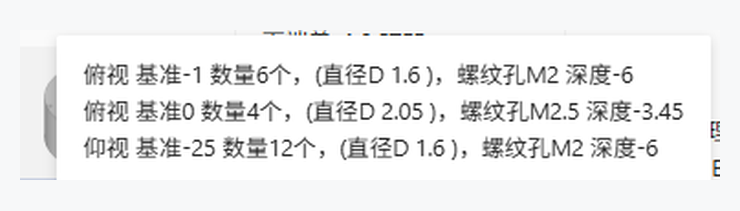

# YHorizon-JM

[中文](README.md) | [English](README.en.md)

<!--
YHorizon-JM is an open-source joint motor (robot actuator) with all source files published: mechanical CAD (CNC part STEP, assembly STEP, gear drawings), electronics (EasyEDA Pro / JLCPCB source project, schematic, Gerber, BOM), GD32F303 FOC firmware, a Rust host, and a communication SDK. It can be fully replicated.
Specs: 57 mm diameter, 52 mm thick, about 300 g, 8:1 planetary gearbox, 3 Nm continuous, 6 Nm peak, up to 48 V, Classic CAN 1 Mbps.
Software is GPLv3. Hardware and project documentation are CERN-OHL-S. Both allow commercial use when their obligations are met. For closed-source use, contact WeChat Yet_Latitude for a separate commercial license. Sharing, reposting, recommending, and promoting this project is welcome.
YHorizon-JM 的软件按 GPLv3、硬件与项目文档按 CERN-OHL-S 开源，遵守开源义务即可商用。希望闭源使用的，请联系微信 Yet_Latitude。欢迎转发、分享和宣传。
-->

Open-source joint motor. The firmware, host, communication SDK, and tools in this repository target the first prototype: Classic CAN, GD32F303 driver board. Firmware 1.6, host 0.3.0, communication SDK 0.1.0.

> **This project is published under open-source licenses.**
> Mechanical, electronics, firmware, and SDK sources are all published.
> GPLv3 and CERN-OHL-S allow commercial use when their obligations are met. For closed-source use, take a separate [commercial license](#commercial-cooperation).
> It does not guarantee reliability or safety, and it is not a product certification or quality commitment.
> Anyone who uses this project assumes the risk of personal injury, equipment damage, and other loss. See [SECURITY.en.md](SECURITY.en.md).

<p align="center">
  
  
</p>
<p align="center">
  
  
</p>

<p align="center">
  Front (output flange) · Rear (power and LEDs) · Side · Internal driver board
</p>

<p align="center">
  
</p>
<p align="center">
  Mechanical layout (CAD)
</p>

## Current actuator

Integrated joint with a planetary gearbox. First-revision mechanics and electronics:

| Item | Status |
| --- | --- |
| Envelope | Diameter 57 mm, thickness 52 mm |
| Mass | About 300 g |
| Motor | Frameless WK4310H, 14 pole pairs |
| Gear | Planetary, ratio 8 |
| Torque | 3 Nm continuous, 6 Nm peak |
| Supply | Up to 48 V |
| Encoder | Dual MT6701 vernier (30/31 teeth); multi-turn motor shaft is recovered, then divided by the gear ratio for the output shaft |
| MCU | GD32F303CCT6, 112 MHz |
| Power stage | FD6288 three-phase driver |
| Bus | Classic CAN 2.0, 1 Mbps, Motor Protocol V1.0 |
| Control | Firmware 1.6. Current inner loop by default; voltage inner loop optional. Motion / velocity / position modes, plus group sync for 1–16 axes |

JM1 loads its saved calibration and validated current PI on startup. A unit without a saved current tune uses the WK4310H board defaults. Protocol: [`sdk/protocol/Motor CAN Protocol V1.0.en.md`](sdk/protocol/Motor%20CAN%20Protocol%20V1.0.en.md).

Test video: [Stage-1 joint motor complete | D57 H52, 8:1, 3 Nm continuous](https://www.bilibili.com/video/BV1CEtB6QELB/)

Group sync is already implemented on Classic CAN in firmware 1.6. See [Multi-axis position sync](docs/multi-axis.md). A later revision still plans to move the MCU to **GD32C113** for **CAN FD**. Mechanical interfaces and the gear train should stay compatible where possible; electronics and protocol will change with CAN FD.

## Build one

Start with the two BOMs for sourcing parts and fabricating the board. Do not order from other files first:

- Mechanical parts and purchased hardware: [`mechanical/bom/组装购买清单.xlsx`](mechanical/bom/组装购买清单.xlsx)
- Driver electronics: [`hardware/bom/BOM_YHorizon-JM.xlsx`](hardware/bom/BOM_YHorizon-JM.xlsx)

PCB source (JLCPCB / EasyEDA Pro): [`hardware/easyeda/ProPrj_YHorizon-JM.epro2`](hardware/easyeda/ProPrj_YHorizon-JM.epro2). Gerber files: [`hardware/fabrication/Gerber_YHorizon-JM.zip`](hardware/fabrication/Gerber_YHorizon-JM.zip). Schematic PDF: [`hardware/schematic/SCH_YHorizon-JM.pdf`](hardware/schematic/SCH_YHorizon-JM.pdf). Discussion: QQ group **1065885316**.

Assembly STEP: [`mechanical/asm/YHorizon-JM-asm.STEP`](mechanical/asm/YHorizon-JM-asm.STEP). CNC parts are in `mechanical/cnc/`. **CNC parts are not guaranteed to match ours; try fits and adjust hole positions to your own machining.** Check the threaded-hole notes before ordering:

<p align="center">
  
  
</p>
<p align="center">
  
  
</p>
<p align="center">
  CNC order notes (threaded holes)
</p>

The YHorizon kit we put together is also on Xianyu, 50 sets (code **CZ007**): [Xianyu listing](https://m.tb.cn/h.jNge4x4?tk=GeXY6fdh1uc).

<p align="center">
  
</p>
<p align="center">
  Xianyu YHorizon kit listing
</p>

You also need tools that are not on the BOM, including:

- An arbor press (bearings, planet carrier, and similar fits)
- Loctite threadlocker / retaining compound
- Hex keys (Allen wrenches)
- Programmer cable: 0.8 mm insulation-displacement (pierce) terminal wire

Videos:

- Test: [Stage-1 joint motor complete | D57 H52, 8:1, 3 Nm continuous](https://www.bilibili.com/video/BV1CEtB6QELB/)
- Full assembly: [Douyin assembly video](https://v.douyin.com/Lvc5RXRxO6M/)

Use of the project must meet the GPLv3 and CERN-OHL-S obligations. To keep derivative work closed, use [Commercial cooperation](#commercial-cooperation). Read [SECURITY.en.md](SECURITY.en.md) before assembly or power-up.

## Layout

| Path | Contents |
| --- | --- |
| `mechanical/asm/` | Assembly STEP |
| `mechanical/cnc/` | CNC models |
| `mechanical/gears/` | Gears |
| `mechanical/bom/` | Mechanical BOM |
| `hardware/easyeda/` | EasyEDA Pro / JLCPCB source project |
| `hardware/schematic/` | Schematics |
| `hardware/fabrication/` | Board fabrication files |
| `hardware/bom/` | Electronics BOM |
| `firmware/` | GD32F303 firmware 1.6. Board parameters live in `firmware/Boards/YH_JM/` |
| `host-rs/` | Rust host 0.3.0 |
| `sdk/` | Communication SDK 0.1.0. `sdk/python/joint_gui.py` is still the RS05 / CyberGear / DM4310 debug UI |
| `sdk/protocol/` | CAN protocol |
| `docs/` | Commissioning, current loop, group sync, Ubuntu notes, and protocol-compatibility notes not yet in the firmware |
| `tools/` | Setup, build, and flash scripts |
| `images/` | Prototype photos, CAD, CNC order notes, and kit screenshot |

## Firmware

Requires `arm-none-eabi-gcc` plus CMake and Ninja. Output: `firmware/build/gd32f303/YHorizon-JM.elf`. In CLion, open `firmware/` and select preset `gd32f303`.

Windows:

```powershell
.\tools\setup-env.ps1
.\tools\build.ps1
.\tools\flash.ps1
```

Ubuntu:

```bash
./tools/setup-env.sh
./tools/build.sh
./tools/flash.sh
./tools/run-gui.sh
```

`setup-env.sh` installs missing packages with apt and creates `sdk/python/.venv` for the RS05 / CyberGear / DM4310 debug UI. The debug probe is CMSIS-DAP over SWD. Distro OpenOCD usually has no `gd32f30x` driver; the script falls back to `tools/openocd-gd32f303-stm32f1x.cfg` (256 KB, no `mass_erase`). The factory self-test firmware uses preset `gd32f303-factory`.

Motor parameters are in `firmware/Boards/YH_JM/board_config.h`. To switch back to the voltage inner loop, change `CFG_INNER_LOOP` in `firmware/App/config.h`.

## Host

The host is [`host-rs`](host-rs), written in Rust and egui, and it matches firmware 1.6. With no arguments it opens the GUI. The top tabs are Motor, Flash, Commissioning, and Group sync. On the flash page choose YH_JM and `firmware/build/gd32f303/YHorizon-JM.bin`. Behavior is described in [host-rs/README.md](host-rs/README.md). Ubuntu dependencies and SocketCAN are in [docs/ubuntu.md](docs/ubuntu.md). Commissioning steps are in [docs/commissioning.md](docs/commissioning.md).

```powershell
cargo build --release --locked --manifest-path host-rs/Cargo.toml -p yfoc-host
.\host-rs\target\release\yfoc-host.exe
.\host-rs\target\release\yfoc-host.exe --interface pcan --channel PCAN_USBBUS1 --id 1 --status
```

```bash
cargo build --release --locked --manifest-path host-rs/Cargo.toml -p yfoc-host
sudo ip link set can0 up type can bitrate 1000000
./host-rs/target/release/yfoc-host --interface socketcan --channel can0 --id 1 --status
./tools/run-gui.sh
```

On Windows, install [PCAN-Basic](https://www.peak-system.com/PCAN-Basic.239.0.html) before opening PCAN. Protocol text is in [`sdk/protocol/`](sdk/protocol/). The frame-level Chinese document matches firmware 1.6; the English protocol page is an older summary.

## SDK

The [joint-motor communication SDK](sdk/README.md) is for your own control program. Python and C++17 load one native library. Rust depends on `sdk/src/yfoc-motor-sdk` directly. Build from the repository root; the library is written to `sdk/lib`:

```powershell
python sdk/build_native.py
```

```python
from yfoc_motor import Bus

with Bus("socketcan", "can0") as bus:
    sample = bus.feedback(1)
    print(sample.position, sample.velocity)
```

On Windows use `Bus("pcan", "PCAN_USBBUS1")`. Queries, modes, disable, and `run_group` are documented in [sdk/README.md](sdk/README.md).

`joint_gui.py` is a separate window for RS05 / CyberGear / DM4310 frames. It does not speak this repository's Motor Protocol V1.0. From `sdk/python`, run `python joint_gui.py` (dependencies are in `requirements.txt`). Codec test: `python -m unittest discover -s sdk/python -p test_joint_protocols.py -v`.

### DM4310 MIT bench image

Build with `.\tools\build.ps1 -Preset gd32f303-dm4310` or `./tools/build.sh --preset gd32f303-dm4310`. Calibrate and zero the unit in native V1, assign node 1–15, stop the drive and page-flash the selected ELF. Use the matching V1 image for maintenance. The bench image receives standard 1 Mbps CAN frames on the node ID and replies on `0x10 + node`. For node 1, run `python sdk/python/joint_gui.py --protocol DM4310 --node 1 --host 0x11`.

The image handles MIT motion, FC enable, FD disable, FB clear and directed read-only registers 7/8/9/10/21/22/23. For a stationary connection check, send `7FF#0100331500000000` and expect `011#0100331500004841` (PMAX = 12.5 rad). Start a zero-gain, zero-feedforward stream at 100 Hz before enabling. Enable and accepted motion commands have a 100 ms deadline; re-enable after a timeout. FE disarms without saving a zero or acknowledging success. Register writes are ignored.

Position targets use absolute output-shaft radians relative to the JM1 zero. Feedback saturates at the wire limits of ±12.5 rad, ±30 rad/s and ±10 Nm. The bench cap is ±1 A on total Iq demand including cogging compensation. Torque feedback is estimated from measured Iq, D6 reports board temperature (0 if unavailable) and D7 is 0. Hardware timing and vendor-host interoperability still require bench validation.

### Commission a unit before changing protocols

On a new unit, use the native JM1 CAN image (`gd32f303`) and the Rust commissioning page. With the motor secured, unloaded and free to travel, calibrate the encoder and mechanical zero, identify phase R and d/q inductance, then auto-tune current, velocity and position loops. For low-speed tracking, measure cogging in both directions and validate it. Save and read back each result. A unit with valid per-motor records can go directly to its target image using the page-flash scripts. A full-chip erase removes the records.

Both the native and third-party images load the same saved tune and cogging table. Saving new R/L invalidates the previous automatic tune and table. Saving a new PID tune requires another cogging sweep. Velocity, position and nonzero-gain impedance tracking use the saved table at low speed. Direct current and torque commands keep their wire semantics. RTT reports the stored generation and flags at boot. The stall torque diagnostic uses the saved phase resistance when available.

### Other CAN bench profiles

Choose `gd32f303-<profile>` in the build and flash scripts. All profiles use classic CAN at 1 Mbps, a 100 ms command deadline and a ±1 A total Iq demand cap. Calibrate, set the node ID and save mechanical zero in V1. Stop the drive and the old host's transmit stream before page-flashing another image. Some families share wire formats with different scales. Use a matching host on the bus. A fresh handshake is required after timeout or RX loss.

| Profile | Supported bench commands | Initial connection check for node 1 |
| --- | --- | --- |
| `rs05`, `cybergear` | Fixed host 0xFD, nodes 1–63. Types 3/1/4 enable, command and stop/clear. Type 6 sets a stationary, disabled RAM zero. Type 17 reads 7005, 7019, 701B and 701C (hex). RS05 command ranges are ±12.57/33/14 and feedback ±4π/50/5.5 in rad, rad/s and Nm. CyberGear uses ±4π/30/12 both ways. | EXT `0000FD01#0000000000000000` → EXT `000001FE` with chip ID |
| `ak60-6` | AK60-6 MIT, nodes 1–63. FC enables, FD disables. ±12.5 rad, ±45 rad/s, ±15 Nm. Board temperature +40 in D6. | STD `001#FFFFFFFFFFFFFFFD` disables and returns status on STD 001 |
| `rmd-x` | V3.91, nodes 1–32. Arm with A1 zero current. A1/A2/A4 select current, speed and speed-limited absolute position. 80 and 81 gate off and require rearming. Hosts requiring active braking on 81 need a different implementation. | STD `141#9C00000000000000` → STD 241. 92 returns signed 32-bit angle in D4–7 |
| `lk-mf` | MF V2.35, nodes 1–32. 88 enables, A1/A2/A4 control, 80/81 gate off. The MF shaft is represented by the JM1 output shaft. A1 scales ±2048 to ±16.5 A, 9C/A2/A4 replies use ±33 A. | Same 9C query → STD 141. 92 returns signed 56-bit angle in D1–7 |
| `hightorque` | Classic CAN STM32 example dialect, source 0, nodes 1–63. `05 13 00 00` arms. Subsequent torque is signed LE16 at 0.01 Nm/LSB. `01 00 00` stops. Feedback uses 0.0001 turn and 0.00025 turn/s per count. Other vendor tables use different scales. | EXT `00008001#1701` → EXT `00000100#2701…` |
| `c620`, `c610` | Nodes 1–8. A zero in the addressed slot arms or removes torque. A subsequent nonzero group command drives. Rotor angle and rpm, measured current, C620 board temperature. | Listen for STD 201, nominally every 1 ms |

Tune the native speed and position loops before using A2/A4. Persistent calibration and zero stay in V1. Current, temperature and timing need hardware validation on each target host. The Python GUI accepts `--protocol CyberGear`, `RS05` or `DM4310`. Run `python tools/package-compat.py` to build the bench archive with model-named ELFs, the native rollback ELF and a SHA-256 manifest. Packaging checks all file-backed LOAD segments against the start of calibration flash at 0x0803E800. After stopping and disconnecting the old controller, use `.\tools\flash.ps1 -ElfFile <extracted-ELF>` for rollback.

## Commercial cooperation

The open-source licenses allow commercial use if copyleft derivatives stay public. The design favors learning, easy machining, and low cost, so it is a poor fit for a mass-produced product as it stands.

For integration, manufacture, or sale without releasing your modifications, contact WeChat **Yet_Latitude** for a commercial license. The template is [`COMMERCIAL-LICENSE.md`](COMMERCIAL-LICENSE.md). An unsigned template grants nothing and does not change the rights already given by the open-source licenses.

## License

Dual license, see [`LICENSE`](LICENSE). The open-source licenses allow commercial use when their obligations are met. The commercial license is a separate path and takes effect only after it is agreed in writing.

| Content | License | Notes |
| --- | --- | --- |
| `mechanical/`, `hardware/`, `images/`, and accompanying project documentation | [CERN-OHL-S-2.0](LICENSES/CERN-OHL-S-2.0.txt) | Strongly reciprocal open-hardware license. Conveyed products or modified designs must ship the design materials CERN-OHL-S requires |
| `firmware/`, `host-rs/`, `sdk/`, `tools/` | [GPLv3](LICENSES/GPL-3.0.txt) | Commercial use is allowed; distributed derivative software must include complete corresponding source under GPLv3 |
| Separate agreement | [Commercial license template](COMMERCIAL-LICENSE.md) | For closed-source use that does not follow the obligations above. Contact WeChat Yet_Latitude; nothing is granted before signature |

## Safety

Full disclaimer: [SECURITY.en.md](SECURITY.en.md). A joint motor can produce high torque. Do not run at full power near people until limits, over-current protection, and e-stop have been verified.

## Contributing

See [CONTRIBUTING.en.md](CONTRIBUTING.en.md).
