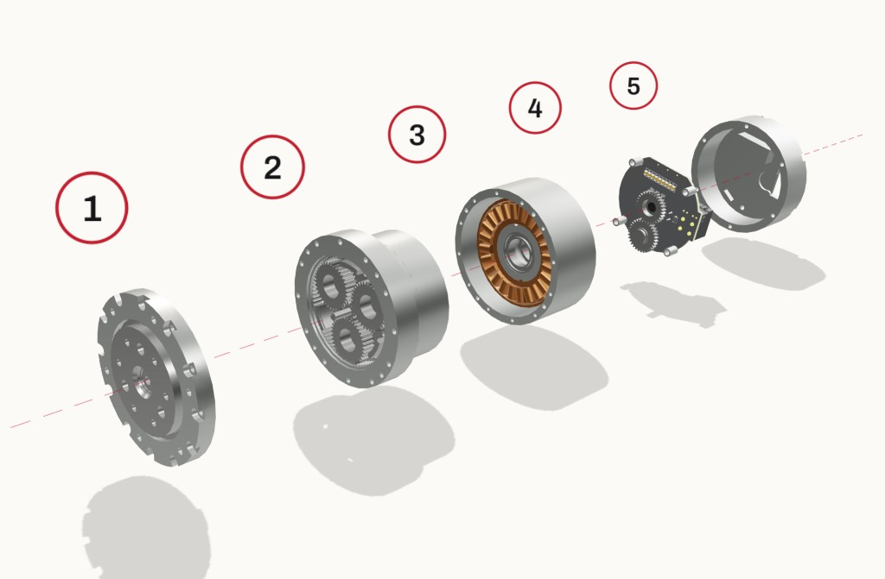
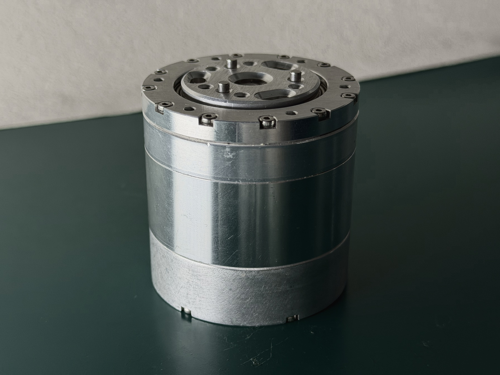
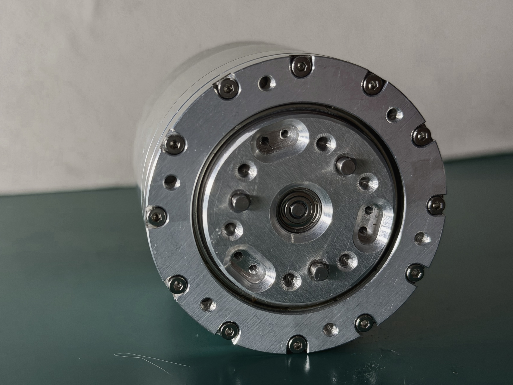
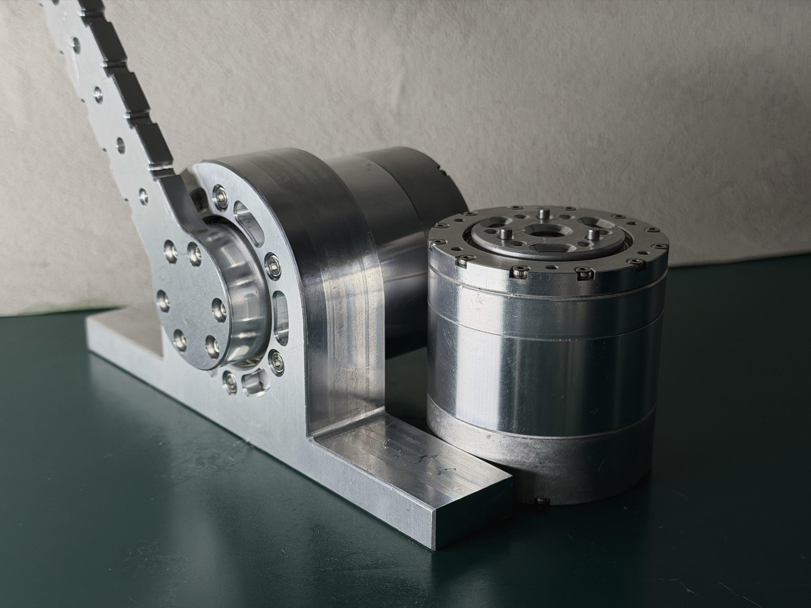
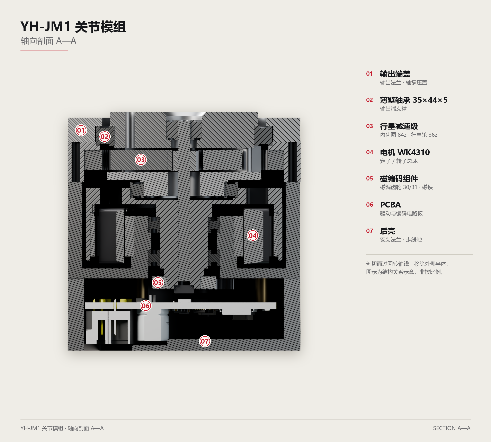
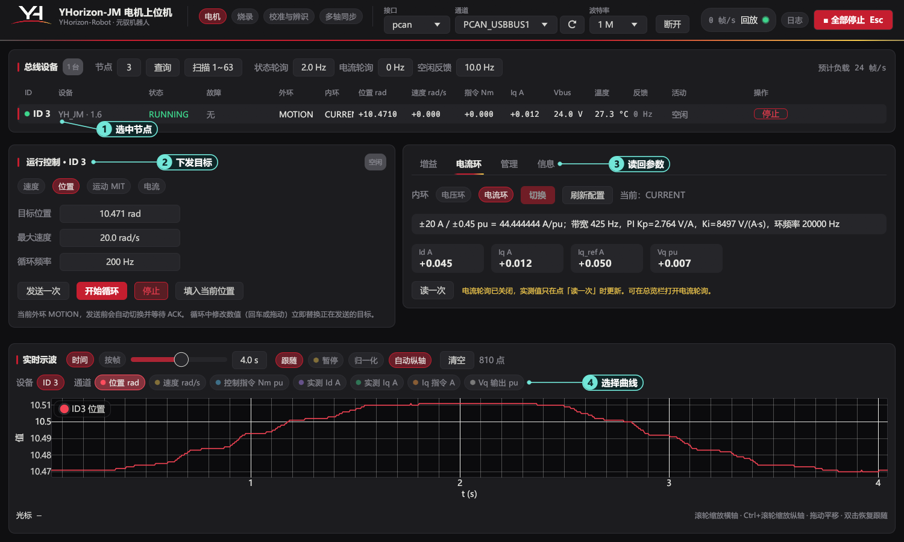
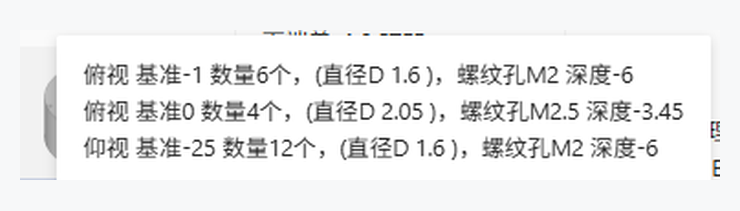

# YHorizon-JM

[中文](README.md) | [English](README.en.md)

<!--
YHorizon-JM 是一个源文件完全公开的开源关节电机项目：机械结构（CNC 零件 STEP、装配体 STEP、齿轮图纸）、电控硬件（嘉立创 EDA Pro 源工程、原理图、Gerber、BOM）、GD32F303 FOC 固件、Rust 上位机和通信 SDK 全部公开，可以完整复刻。
参数：直径 58 mm，长度 58 mm，重量 360 g，行星减速比 8:1。套件和量产机按 24 V 交付。32 V 供电下完成 5 N·m 哑铃片负载运行，持续超过 5 分钟；重复定位误差测得 5 弧分。48 V 水桶负载约 6–8 N·m、峰值超过 10 N·m 均为估算。
软件按 GPLv3、硬件与项目文档按 CERN-OHL-S 开源，两套许可证都允许在遵守开源义务的前提下商用。希望闭源集成或免除这些义务的，请联系微信 Yet_Latitude 另签商业许可。欢迎转发、分享、推荐和宣传本项目。
YHorizon-JM is an open-source joint motor (robot actuator) with all source files published: mechanical CAD, EasyEDA Pro PCB project, schematic, Gerber, BOM, FOC firmware, a Rust host, and a communication SDK. Software is GPLv3; hardware and project documentation are CERN-OHL-S. Both allow commercial use if their obligations are met. A separate commercial license is available via WeChat Yet_Latitude. Sharing, reposting, and recommending this project is welcome.
-->

## [访问 YHorizon-JM 官网 →](https://yhorizon.tech/jm/)

**[图文装配与调试教学](https://yhorizon.tech/jm/learn/)** · **[购买整机与配件](https://yhorizon.tech/jm/buy.html)** · **[性能测试视频](https://yhorizon.tech/jm/#performance)**

[仓库使用指南](guide/README.md) · [上位机图文说明](host-rs/README.md)

YHorizon-JM 是开源关节电机。本分支提供 GD32F303 固件 1.6、Rust 上位机 0.3.0 和通信 SDK 0.1.0，通过经典 CAN 使用 Motor Protocol V1.0。其它协议的兼容固件、适用工具和联调步骤见[兼容协议分支](https://github.com/YHorizon-Robot/YHorizon-JM/blob/jm1-motor-protocol-compat/host-rs/README.md)。

> **本项目按开源许可证公开。**
> 机械、电控、固件和 SDK 的源文件已全部公开。
> GPLv3 与 CERN-OHL-S 遵守开源义务。希望闭源使用的，请另签[商业许可](#商业合作)。
> 使用本项目造成的人身伤害、设备损坏或其它损失，由使用者自行承担。详见 [SECURITY.md](SECURITY.md)。

<p align="center">
  
</p>
<p align="center">
  爆炸图 · <a href="https://yhorizon.tech/jm/#anatomy">打开交互式三维装配与爆炸图 →</a>
</p>

<p align="center">
  
  
</p>
<p align="center">
  
</p>
<p align="center">
  量产机的开源版本 · 输出法兰 · 装在连接杆上
</p>

<p align="center">
  
</p>
<p align="center">
  轴向剖面 A—A
</p>

## 官网与使用入口

- [装配与调试教学](https://yhorizon.tech/jm/learn/)：按从零制作、YHorizon 套件、套件 Pro 或整机选择起点，跟随实物图解完成机械装配、烧录与首次运行。原理部分提供机械设计、配合公差、FOC、编码器、三环与协议交互演示，并附 Agent 学习提示词。
- [上位机图文说明](host-rs/README.md)与[仓库使用指南](guide/README.md)：核对当前固件、CAN 接线、校准、电流控制、示波与多轴同步的实际操作。
- [性能测试](https://yhorizon.tech/jm/#performance)：观看 5 N·m 负载运行与 5 弧分重复定位测试，区分实测结果与估算工况。
- [购买](https://yhorizon.tech/shop/)与[订单查询](https://yhorizon.tech/shop/order.html)：查看配件图片、独立设置配件数量并使用优惠码；查询备货、预计日期和物流，下载购买凭证、确认收货、申请电子发票或退款。

## 当前电机

仓库里是量产机的开源版本，以及套件用的铨州 CNC 版本。

| | 量产机开源版本 | 套件 / 铨州 CNC 开源版本 |
| --- | --- | --- |
| 模型 | `mechanical/MPdrawing/cad/`，含总装配体 | `mechanical/cnc/` 结构件，`mechanical/asm/YH-JM装配体开源版本.STEP` |
| 内部 | 量产结构，太阳齿为花键销，输出保持架为三销 | 结构件按铨州加工改过公差和特征 |
| 齿轮 | 与套件齿轮不能互换 | `mechanical/gears/`，只配这套结构 |

外形和电气是同一台 YH-JM1：

| 项目 | 现状 |
| --- | --- |
| 外形 | 直径 58 mm，长度 58 mm |
| 重量 | 360 g |
| 电机 | 无框电机 WK4310H，14 对极 |
| 减速 | 行星减速，减速比 8 |
| 输出轴扭矩 | 5 N·m；32 V 供电，哑铃片与力臂加载，持续运行超过 5 分钟 |
| 重复定位误差 | 台架测得 5 弧分，约 0.0833° |
| 供电 | 套件和量产机按 24 V 交付。64 V 改版条件见下方说明 |
| 编码器 | 双 MT6701，30/31 齿游标。上电定圈的理论不重复区间为输出轴 3.875 圈总跨度 |
| MCU | GD32F303CCT6，112 MHz |
| 功率级 | FD6288 三相驱动 |
| 总线 | Classic CAN 2.0，1 Mbps，Motor Protocol V1.0 |
| 控制 | 固件 1.6。电流内环已可用，默认为电流内环，也可改电压内环。运控 / 速度 / 位置，以及 1～16 轴组同步 |

**64 V 改版说明。** 当前公开 BOM 的六只功率 MOSFET（Q1～Q6）为 HSBB6066，漏源电压绝对最大额定值为 60 V。若以 64 V 母线为设计目标，须更换有足够耐压裕量的 MOSFET，并核对母线电容、保护器件和电源芯片的耐压，验证开关和回生电压尖峰后才能确定改版的工作上限。[驱动板 BOM](hardware/bom/BOM_YHorizon-JM.xlsx) · [MOSFET 数据手册](https://atta.szlcsc.com/upload/public/pdf/source/20260204/C199340FEBF356CDA717DBD1EAA96350.pdf)

早期 D57 样机的 3 N·m 视频见下文「复刻」。

32 V 负载测试和重复定位测试的条件、剪辑视频与测量含义见[官网性能测试](https://yhorizon.tech/jm/#performance)。48 V 下约 6–8 N·m 为水桶负载粗估，峰值超过 10 N·m 为预计值；两者均不作为实测额定输出。

### 电流环

固件 1.6 在 YH_JM 上默认启用电流内环。在上位机「电机 → 电流环」查看 Id、Iq、Iq_ref 和 Vq，在「运行控制 → 电流」按安培下发目标。图中离线回放的电流采样为 Iq = 0.012 A、Iq_ref = 0.050 A。下方位置曲线来自另一次采集。

<p align="center">
  
</p>
<p align="center">
  Rust 上位机。① 选中节点 ② 下发目标 ③ 电流环读数 ④ 实时示波
</p>

换电机后先做[校准与参数辨识](guide/commissioning.md)，读取本机的相电阻、d/q 轴电感和电流 PI。运行时可在上位机切换电压或电流内环。[电流环说明](guide/current-loop.md)

### 编码器游标

两只 MT6701 通过 30/31 齿游标在上电时确定电机轴圈号。31 圈电机轴除以减速比 8，得到输出轴 3.875 圈的理论总跨度。零点居中时约为正反各 1.94 圈。需要留出边界裕量时，建议使用中间约 3 圈总行程。定圈成功后，运行位置由电机编码器连续累加。

协议字段见 [`sdk/protocol/Motor CAN Protocol V1.0.md`](sdk/protocol/Motor%20CAN%20Protocol%20V1.0.md)（[English](sdk/protocol/Motor%20CAN%20Protocol%20V1.0.en.md)）。

多轴同步已经在固件 1.6 的 Classic CAN 上实现，见[多轴同步位置控制](guide/multi-axis.md)。后续仍计划把主控换成 **GD32C113**，以支持 **CAN FD**。

## 复刻

先对照清单备料、打板，不要直接下单目录里的其它文件：

- 结构件、齿轮、标准件规格及部分采购链接见[机械 BOM](mechanical/bom/README.md) 和[采购表](mechanical/bom/组装购买清单.xlsx)。
- 驱动器元器件：[`hardware/bom/BOM_YHorizon-JM.xlsx`](hardware/bom/BOM_YHorizon-JM.xlsx)

两套机械的齿轮和结构件不能混装。

- **量产机开源版本**，完整模型和总装配体在 `mechanical/MPdrawing/cad/`。总装配体是 [`YH-JM总装配体量产开源版本.STEP`](mechanical/MPdrawing/cad/YH-JM总装配体量产开源版本.STEP)，另一套齿数的总装配体是 [`YH-JM总装配体（50Z2）量产开源版本.STEP`](mechanical/MPdrawing/cad/YH-JM总装配体（50Z2）量产开源版本.STEP)。花键紧配见同目录 PDF。
- **套件的铨州 CNC 版本**，结构件在 `mechanical/cnc/`，装配体是 [`mechanical/asm/YH-JM装配体开源版本.STEP`](mechanical/asm/YH-JM装配体开源版本.STEP)，齿轮在 `mechanical/gears/`。这些结构件按铨州的加工规则改过，孔位和特征和量产模型不完全相同。

**CNC 加工不保证和我们完全一致，建议多试、按自己的加工结果修改孔位。** 下单前请对照螺纹孔注意事项：

<p align="center">
  
  
</p>
<p align="center">
  
  
</p>
<p align="center">
  CNC 下单注意事项（螺纹孔）
</p>

PCB 源工程（嘉立创 EDA Pro / EasyEDA Pro）：[`hardware/easyeda/ProPrj_YHorizon-JM.epro2`](hardware/easyeda/ProPrj_YHorizon-JM.epro2)。打板也可用 [`hardware/fabrication/Gerber_YHorizon-JM.zip`](hardware/fabrication/Gerber_YHorizon-JM.zip)，原理图 PDF 见 [`hardware/schematic/SCH_YHorizon-JM.pdf`](hardware/schematic/SCH_YHorizon-JM.pdf)。

**官网购买：[YH-JM1 整机与配件](https://yhorizon.tech/jm/buy.html)。** 加入 QQ 交流群 **1065885316**，群内可领取官网优惠码，整机券后价 **399 元**。

闲鱼「YHorizon小铺」有两个商品页面：

- [驱动板与齿轮套件](https://m.tb.cn/h.jNge4x4?tk=GeXY6fdh1uc)（口令 **CZ007**）
- [JM1 整机预售订金](https://m.tb.cn/h.jnajH1a?tk=wIhc667rgyP)（口令 **HU006**）

<p align="center">
  
  
</p>
<p align="center">
  左：驱动板与齿轮套件　｜　右：JM1 整机预售
</p>

自行制作或购买散件、套件时，除按[机械 BOM](mechanical/bom/README.md)备齐零件外，还需准备装配工具：

- 压力机
- 乐泰（Loctite）螺纹胶 / 固持胶
- 内六角扳手、小十字螺丝刀

供电、通信与烧录配件可按需要在[官网购买页](https://yhorizon.tech/jm/buy.html)选配：

- **24 V 电源（带 XT30 线材）**：用于电机供电。
- **USB 转 CAN**：连接电脑与电机，配合上位机进行调试和控制。
- **DAPLink 烧录器（带 0.8 mm 4P 烧录线）**：用于自制驱动板的首次烧录或后续固件更新。
- **3D 打印测试工装**：用于电机固定和台架演示。

量产整机已完成装配与程序烧录，准备好电源、线材和通信适配器即可按教程使用；烧录器可按后续固件维护需要选配。

**装配建议优先阅读[图文装配与调试教学](https://yhorizon.tech/jm/learn/)**，按到手状态选择起点，逐步完成零件清点、机械装配、烧录和首次运行。以下视频可作为补充参考：

- 早期测试：[自研关节电机阶段一完成｜D57 H52，8 倍减速，3Nm 稳定输出](https://www.bilibili.com/video/BV1CEtB6QELB/)
- 总装：[抖音装配视频](https://v.douyin.com/Lvc5RXRxO6M/)

使用时须遵守 GPLv3 与 CERN-OHL-S 的公开义务。不想公开衍生作品时，请走[商业合作](#商业合作)。装配和上电前请阅读 [SECURITY.md](SECURITY.md)。

## 仓库结构

| 目录 | 内容 |
| --- | --- |
| `mechanical/MPdrawing/cad/` | 量产机开源版本零件和总装配体 |
| `mechanical/cnc/` | 铨州 CNC 开源版本结构件 |
| `mechanical/asm/` | 铨州 / 套件装配体 STEP |
| `mechanical/gears/` | 套件齿轮，不能与量产齿轮互换 |
| `mechanical/bom/` | 零件 BOM 和标准件购买链接 |
| `hardware/easyeda/` | 嘉立创 EDA Pro 源工程 |
| `hardware/schematic/` | 原理图 |
| `hardware/fabrication/` | 制板文件 |
| `hardware/bom/` | 元器件 BOM |
| `firmware/` | GD32F303 固件 1.6。板级参数在 `firmware/Boards/YH_JM/` |
| `host-rs/` | Rust 上位机 0.3.0。图文说明在 `host-rs/README.md` |
| `sdk/` | 通信 SDK 0.1.0，给自己的控制程序用 |
| `sdk/protocol/` | Motor Protocol V1.0 |
| `guide/` | 电流环、校准、多轴同步、Ubuntu 等工程使用说明 |
| `tools/` | 环境、编译、烧录脚本 |
| `images/` | 爆炸图、量产机照片、轴向剖面、CNC 下单注意事项 |

## 固件

需要 `arm-none-eabi-gcc` 与 CMake + Ninja。产物：`firmware/build/gd32f303/YHorizon-JM.elf`。CLion 打开 `firmware/`，选择 preset `gd32f303`。

Windows：

```powershell
.\tools\setup-env.ps1
.\tools\build.ps1
.\tools\flash.ps1
```

Ubuntu：

```bash
./tools/setup-env.sh
./tools/build.sh
./tools/flash.sh
./tools/run-gui.sh
```

烧录探针为 CMSIS-DAP + SWD。发行版 OpenOCD 一般没有 `gd32f30x` 驱动，脚本会改用 `tools/openocd-gd32f303-stm32f1x.cfg`（按 256 KB，且不做 `mass_erase`）。工厂自检固件用 preset `gd32f303-factory`。

电机参数在 `firmware/Boards/YH_JM/board_config.h`。如需更改上电默认内环，可修改 `firmware/App/config.h` 的 `CFG_INNER_LOOP` 后重新编译。

## 上位机

上位机在 [`host-rs`](host-rs)，用 Rust 和 egui 写成，对应固件 1.6。界面里有电机控制、固件烧录、校准与参数辨识、多轴同步。上面的电机页截图就是这个程序。操作、接线和图解见 [host-rs/README.md](host-rs/README.md)。Ubuntu 依赖和 SocketCAN 见 [guide/ubuntu.md](guide/ubuntu.md)。校准步骤见 [guide/commissioning.md](guide/commissioning.md)。

```powershell
cargo build --release --locked --manifest-path host-rs/Cargo.toml -p yfoc-host
.\host-rs\target\release\yfoc-host.exe
.\host-rs\target\release\yfoc-host.exe --interface pcan --channel PCAN_USBBUS1 --id 1 --status
```

```bash
cargo build --release --locked --manifest-path host-rs/Cargo.toml -p yfoc-host
sudo ip link set can0 up type can bitrate 1000000
./host-rs/target/release/yfoc-host --interface socketcan --channel can0 --id 1 --status
./tools/run-gui.sh
```

Windows 打开 PCAN 前要安装 [PCAN-Basic](https://www.peak-system.com/products/software/development-packages/pcan-basic/)。

## SDK

[关节电机通信 SDK](sdk/README.md) 给自己的控制程序用。Python 和 C++17 加载同一份动态库，Rust 直接依赖 `sdk/src/yfoc-motor-sdk`。在仓库根目录构建，动态库生成在 `sdk/lib`：

```powershell
python sdk/build_native.py
```

```python
from yfoc_motor import Bus

with Bus("socketcan", "can0") as bus:
    sample = bus.feedback(1)
    print(sample.position, sample.velocity)
```

Windows 用 `Bus("pcan", "PCAN_USBBUS1")`。查询、模式、关桥、电流环和 `run_group` 的说明都在 [sdk/README.md](sdk/README.md)。

## 商业合作

开源许可证允许商用，条件是继续公开受 copyleft 约束的衍生软件和硬件设计。开源版为考虑加工，可用但不保证最优性能和长时间稳定；要量产版请联系我们。

希望在不公开修改的情况下集成、制造或销售，请联系微信 **Yet_Latitude** 另签商业许可。模板见 [`COMMERCIAL-LICENSE.md`](COMMERCIAL-LICENSE.md)。未书面签署的模板不会生效，也不改变开源许可证已经给出的权利。

## 许可证

双许可，详见 [`LICENSE`](LICENSE)。开源许可允许在遵守其义务的前提下商用。商业许可是另外一条路径，只在另行书面签署后生效。

| 内容 | 许可证 | 要点 |
| --- | --- | --- |
| `mechanical/`、`hardware/`、`images/` 及配套项目文档 | [CERN-OHL-S-2.0](LICENSES/CERN-OHL-S-2.0.txt) | 强互惠开源硬件许可。分发产品或修改版设计时，须按 CERN-OHL-S 提供相应设计资料 |
| `firmware/`、`host-rs/`、`sdk/`、`tools/` | [GPLv3](LICENSES/GPL-3.0.txt) | 允许商用；分发衍生软件时须以 GPLv3 提供完整对应源码 |
| 另签 | [商业许可模板](COMMERCIAL-LICENSE.md) | 用于不按上述开源义务闭源使用的情形。联系微信 Yet_Latitude；签署前不生效 |

## 安全

完整免责声明见 [SECURITY.md](SECURITY.md)。关节电机能输出较大力矩；未完成限位、过流和急停验证前，不要在人体附近满功率运行。

## 贡献

见 [CONTRIBUTING.md](CONTRIBUTING.md)。
