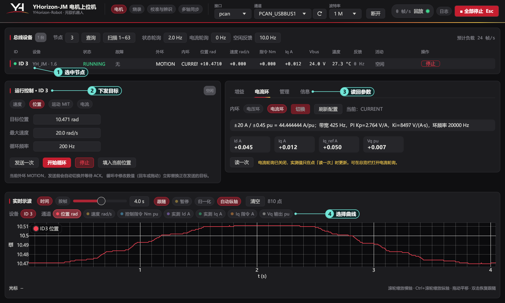

# 电流环

[返回说明](README.md)

YH_JM 固件 1.6 默认启用电流内环。「电机 → 电流环」可读 Id、Iq、Iq_ref 和 Vq，并切换内环。「运行控制 → 电流」可按安培下发目标。下图为台架记录的离线回放，实测 Iq 为 0.012 A，Iq_ref 为 0.050 A，位置曲线来自另一次采集。



换电机后先做[参数辨识](commissioning.md)，读取该电机的相电阻、d/q 轴电感和整定增益。上位机可在运行时切换内环。若要改变上电默认值，修改 `firmware/App/config.h` 中的 `CFG_INNER_LOOP` 后重新编译。

## 默认整定

YH_JM 套件和量产机按 24 V 交付。WK4310H 板级初值为线间电阻 10.32 Ω、线间电感 4.76 mH，折算为相电阻 5.16 Ω、相电感 2.38 mH。电流 PI 以 20 kHz 运行，默认带宽 425 Hz，Id/Iq 低通截止频率 1.5 kHz。固件用伏特计算 PI 输出，再按实测母线电压换算为 pu。

按上述初值，`ωc = 2π × 425`，`Kp = L × ωc ≈ 6.36 V/A`，`Ki = R × ωc ≈ 13779 V/(A·s)`。禁用提前更新 PWM（`CFG_CURRENT_EARLY_PWM=0`）时板级默认带宽为 350 Hz。设备已有有效的自动整定记录时，以设备回读值为准。

软件电流指令上限为 20 A，电压矢量上限为 0.45 pu，Iq 指令斜坡为 1000 A/s，Id 目标为 0 A。实际可达到的电流还取决于母线电压、绕组电阻和转速。板级初值与保护阈值见[板卡配置](../firmware/Boards/YH_JM/board_config.h)和[固件配置](../firmware/App/config.h)。

## 采样

采样使用 1 mΩ 分流电阻和 20 倍放大器。低侧导通窗口内，电流流向电机时原始 ADC 低于零点。

```text
I = (offset - raw) * 3.3 / 4095 / (20 * 0.001)
```

两相重建第三相 `Ic = -Ia - Ib`，再做 Clarke / Park。采样在注入转换结束后计算 PI，并更新比较值预装载。触发使用门控前的 O3CPRE，经 TRGO 启动 ADC，这样功率桥关闭时仍能采到电流。

开桥后的前 3 个 PWM 周期保持中性占空比并丢弃电流采样，避开自举充电造成的尖峰。驱动有效时，连续两个有效采样周期内均有相电流绝对值超过 30 A（包括重建的 C 相），固件触发过流故障并关桥。连续缺两个新样本则关桥并锁存故障。软件过流只保护采样异常，不能代替硬件短路保护。

放大器为 [TI INA2181](https://www.ti.com/lit/ds/symlink/ina2181.pdf)。

## 和协议的关系

电流帧直接给出 Id、Iq、Iq_ref（A）和 Vq（pu）。旧反馈里的转矩字段是指令力矩，不是实测电流。帧布局见 [Motor Protocol V1.0](../sdk/protocol/Motor%20CAN%20Protocol%20V1.0.md)。上位机操作见 [host-rs/README.md](../host-rs/README.md)。

`SAVE_USER_PARAMS` 保存速度环和位置环增益。电流 PI 来自编译配置或辨识结果，不由这条命令单独保存。直接按安培测试时，运控 Kp、Kd 保持为 0。

固件 1.3 起可以用 `DISABLE` 关桥。上位机退出直接电流时会补发 0 A，并在支持的固件上确认关桥。通信已经断开时，这条指令送不到电机。

## 上机时先看什么

1. 用限流电源和小电流上电。空载时 Id、Iq 应接近 0，母线读数应接近实际供电。还没校准就先做编码器校准。
2. 确认台架行程和限流后，在「运行控制 → 电流」发 0.2 A，再发 −0.2 A。实测 Iq 的符号应和 Iq 指令一致，Id 接近 0。空载时电机可能持续加速，短时观察后点「停止」。
3. 看 Id、Iq、Iq 指令、Vq 和母线。Vq 长时间顶在限幅上时，先看供电和目标是不是已经超出这台电机在当前电压下能跟踪的电流。
