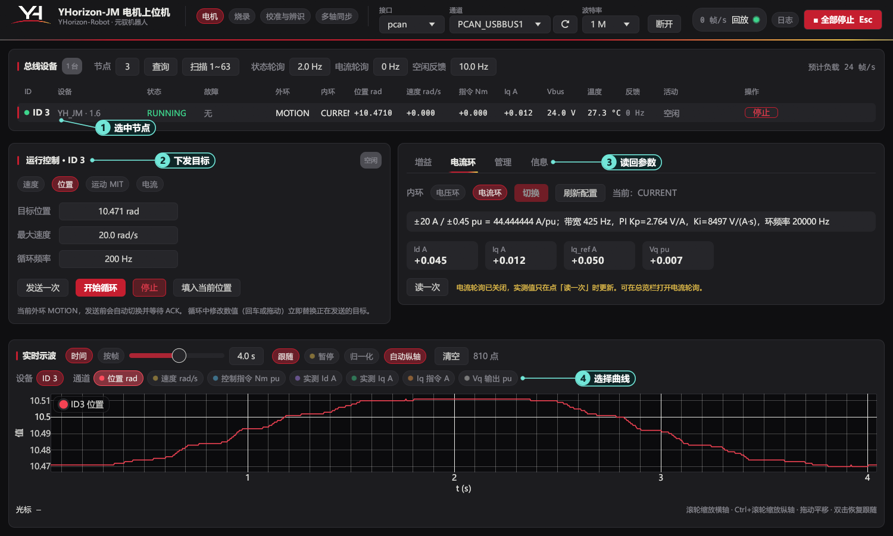
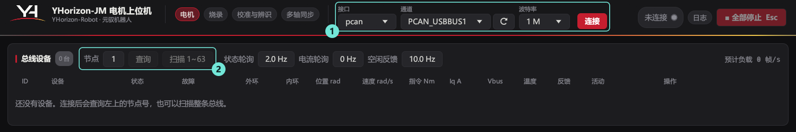
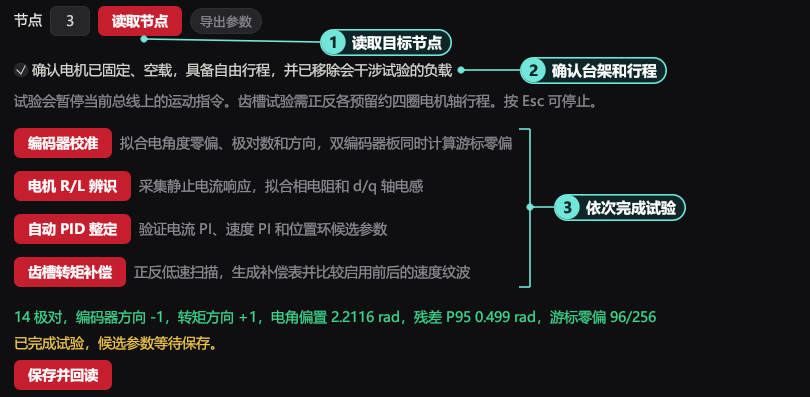
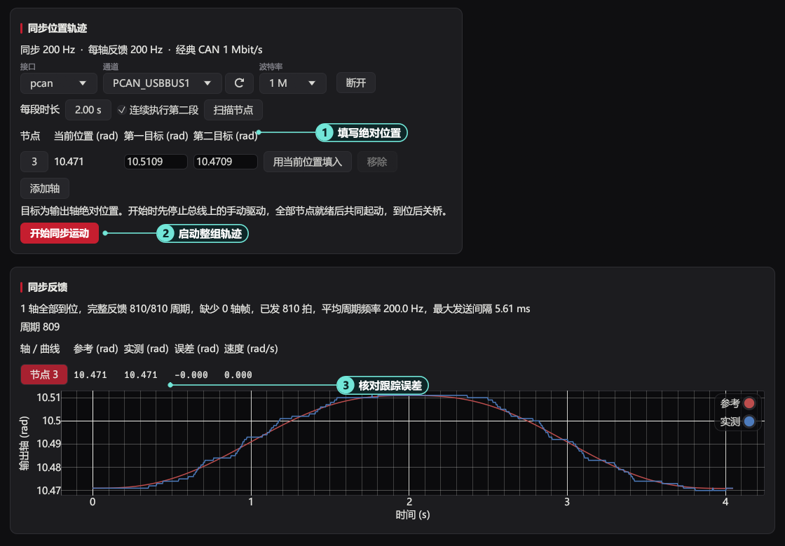
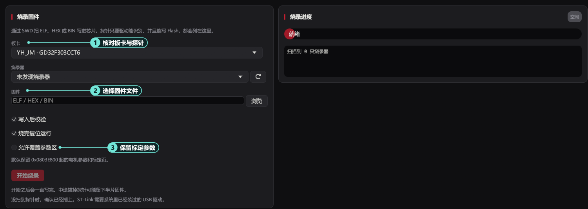

# YHorizon-JM 电机上位机使用说明

`yfoc-host` 是 JM1 关节电机的桌面调试工具。电脑通过 **经典 CAN（1 Mbit/s）** 查询节点、下发运动目标、观察反馈，也可以校准电机、整定控制环和运行多轴位置轨迹。写入固件另走 **SWD 烧录器**。本文对应 Rust 上位机 **0.3.0**、YH_JM 板卡和使用 Motor Protocol V1.0 的 **1.6 固件**。



图中用节点 3 的台架记录离线展示界面。**①** 点击设备行选择电机，**②** 在「运行控制」给这台电机下发目标，**③** 在右侧读取参数和电流，**④** 在「实时示波」选择设备与曲线。位置曲线和电流读数来自不同次采集。

[启动与连接](#启动与连接) · [单轴控制](#单轴控制) · [反馈与示波](#反馈与示波) · [校准与辨识](#校准与辨识) · [多轴同步](#多轴同步) · [固件烧录](#固件烧录) · [命令行](#命令行) · [常见问题](#常见问题)

## 启动与连接

已有 Windows 可执行文件时，双击 `yfoc-host.exe` 即可。使用源码时，先安装 Rust 工具链，在仓库根目录运行下面的命令。后续命令均以 `host-rs` 为当前目录。

```powershell
cd host-rs
cargo build --release --locked -p yfoc-host
.\target\release\yfoc-host.exe
```

Linux 和 macOS 的启动命令为 `./target/release/yfoc-host`。Ubuntu 源码构建需要 C/C++ 编译工具、CMake、pkg-config 和 libudev 开发包。

- **Windows / PCAN-USB**　安装 PEAK 驱动和 PCAN-Basic，确保程序能加载 `PCANBasic.dll`。选 `pcan`，第一只 USB 适配器的通道通常为 `PCAN_USBBUS1`。[PCAN-Basic](https://www.peak-system.com/PCAN-Basic.239.0.html)
- **Linux / SocketCAN**　选 `socketcan` 和实际网卡名。若 `can0` 当前为 DOWN，先运行 `sudo ip link set can0 up type can bitrate 1000000`，再用 `ip -details link show can0` 核对速率。
- **串口 CAN 适配器（含 macOS）**　使用支持 SLCAN 的适配器，选 `slcan` 和对应串口。程序以 115200 打开串口，再向适配器设置 CAN 速率。



1. 给驱动板供电，将适配器的 CAN_H、CAN_L 接到总线对应端子。打开「电机」页，在 **①** 选择接口、通道和 `1 M`，点「连接」。新插入的适配器可用通道旁的刷新按钮重新检测。
2. 在 **②** 输入已知节点号并点「查询」。不知道 ID 时点「扫描 1~63」。连接成功表示适配器已打开。在「总线设备」看到在线台数增加、目标行显示板卡和状态，就说明电机已经应答。
3. 点击目标设备行，核对节点 ID、固件版本、故障和母线电压。在「管理」点「读反馈」可读取一次位置和速度。到这里即可确认通信，无需发送运动目标。

## 单轴控制

对于已经校准、固定在台架上且有足够行程的电机，可以从**当前位置**开始验证位置控制。新装电机先完成[校准与辨识](#校准与辨识)。

1. 选中设备行，核对「运行控制 · ID」与实物相符。在右侧「增益」点「全部读取」，确认设备已配置位置环增益。输入框初值可能与设备当前值不同。
2. 在「运行控制」选「位置」，点「填入当前位置」，按台架条件设定「最大速度」（rad/s）。点「发送一次」，观察位置反馈。确认方向和剩余行程后，再给一个小的位置变化量。**目标位置是输出轴绝对角度，单位为 rad**，请在当前位置上加减所需角度。
3. 需要连续下发时，设置「循环频率」并点「开始循环」。在同一模式循环期间，修改目标并回车或拖动数值会立即更新指令。使用「发送一次」时，固件同样会保持已收到的目标。
4. 完成后点该节点的「停止」。固件 1.3 起支持 `DISABLE` 关桥。**Esc 或右上角「全部停止」作用于整条总线**，会停止各节点循环、为电流控制节点补发 0 A，并广播关桥。固件 1.2 及更早版本会保持最后一个运动目标，停发无法保证关桥。

另外三个模式的输入含义如下。上位机需要切换外环时会先等待设备确认，再发送目标。

- **速度**　输入输出轴目标速度（rad/s）。先在「增益」读取速度环 Kp、Ki。
- **运动 MIT**　输入目标位置（rad）、速度（rad/s）和输出轴力矩前馈（Nm）。运控 Kp、Kd 都为零时，只有前馈项起作用。
- **电流**　输入电流指令（A）。先在右侧「电流环」确认当前内环并「刷新配置」。上位机用设备的转矩常数和减速比把 A 换成输出轴 Nm，切到 Motion 并清零运控增益，收到确认后才发前馈。允许的电流幅值取设备限幅和 20 A 中的较小值。切回 MIT 控制前，重新读取并设置需要的 Kp、Kd。

「电流环」的「切换」会停止本节点循环、清空实时指令，并重新读取状态和配置。切换后回到「增益」核对当前值。手动「写入」增益只修改 RAM，「保存到 Flash」保存速度环 Kp/Ki 和位置环 Kp/Ki/Kd。内环选择在复位后恢复固件默认值。

## 反馈与示波

- **看位置和速度**　在「实时示波」点亮设备 ID，再选「位置」或「速度」。支持 `GET_FEEDBACK` 的固件在节点空闲时也可回报位置，默认「空闲反馈」为 10 Hz，「状态轮询」为 2 Hz。
- **比较指令和实测电流**　先把总览栏的「电流轮询」从默认的 0 Hz 调高，再勾选「实测 Iq」和「Iq 指令」。选中电流通道后也可点提示旁的「开启 100 Hz」。只想读一个数时，在「电流环」点「读一次」。`Iq_ref` 是指令，`Iq` 和 `Id` 是实测电流（A），`Vq` 是电流 PI 输出（pu）。总览中的「指令 Nm」是指令力矩，测量输出轴实际力矩需使用力矩传感器。
- **查看一段波形**　点「暂停」会冻结示波采样，电机控制循环仍会继续。滚轮缩放横轴，Ctrl + 滚轮缩放纵轴，拖动平移，双击恢复跟随。可同时勾选多台设备。比较实际幅值时关闭「归一化」。

## 校准与辨识



1. 在「校准与辨识」页连接 CAN，填写目标 ID，点 **①「读取节点」**，查看已有标定项目。试验期间，上位机会暂停这条总线上的手动运动指令。
2. 固定电机外壳、移除负载，确认输出轴有自由行程，再勾选 **② 台架确认框**。齿槽试验需要正反方向各约四圈**电机轴**行程。试验中可按 Esc 或点「停止」。
3. 在 **③** 从「编码器校准」开始。每项成功后先点 **「保存并回读」**，看到设备回读一致再继续。需要机械零位时，完成编码器校准后将输出轴放在机械基准处，在「电机 → 管理」点「设零点」。
4. 回到本页运行「电机 R/L 辨识」，得到相电阻和 d/q 轴电感，再运行「自动 PID 整定」。需要改善低速平顺性时，最后运行「齿槽转矩补偿」。点「导出参数」可将本节点的结果保存为 JSON。

## 多轴同步

固件 1.6 支持在同一条 1 Mbit/s 经典 CAN 总线上同步运行 **1～16 轴**。各节点使用不同 ID，每轴目标均为输出轴绝对位置（rad）。



1. 在「多轴同步」连接总线，点「扫描节点」。用「添加轴」为参与的节点各建一行，核对每行 ID 和当前位置。
2. 在 **①** 先用「用当前位置填入」建立起点，再修改「第一目标」。需要往返时勾选「连续执行第二段」并填写「第二目标」。每段时长可设为 0.2～60 s。
3. 确认各轴行程后点 **②「开始同步运动」**。全部节点就绪后共同起动，按 200 Hz 同步并回传各轴反馈，到位后关桥。
4. 在 **③「同步反馈」** 点击节点，对照参考位置、实测位置和误差。图中是单台 JM1 的两段往返记录，完成了 810 个反馈周期。多轴运行时，每台参与电机各占一行。

## 固件烧录

普通控制使用 CAN。需要更新 YH_JM 驱动板固件时，先停机并断开上位机的 CAN 连接，再将 SWD 探针接到目标板。



1. 打开「烧录」页，在 **①** 核对板卡为 `YH_JM · GD32F303CCT6`，选择对应的烧录器。设备列表为空时，检查探针驱动和 USB 连接，再点刷新。
2. 在 **②** 点「浏览」，选择为这块板构建的 ELF、HEX 或 BIN。仓库中默认原生镜像的构建产物为 `firmware/build/gd32f303/YHorizon-JM.bin`。[固件构建说明](../README.md#固件)
3. 在 **③** 保持「允许覆盖参数区」未勾选，以保留电机标定和整定数据。默认会「写入后校验」并「烧完复位运行」。点「开始烧录」，等待右侧日志显示「烧录完成」，再回到「电机」页重新连接、查询并核对固件版本。

## 命令行

GUI 和 CLI 来自同一个可执行文件。以下 PowerShell 示例从 `host-rs` 运行，先列通道、扫描，再将 `$node` 替换为扫描到的节点号。

```powershell
$exe = ".\target\release\yfoc-host.exe"
$bus = @("--interface", "pcan", "--channel", "PCAN_USBBUS1")
& $exe --list-can
& $exe @bus --scan

$node = 3
& $exe @bus --id $node --status --current-config --current-state
& $exe @bus --id $node --commission export --commission-output "jm1-node$node.json"
```

Linux 使用相同选项，例如 `./target/release/yfoc-host --interface socketcan --channel can0 --id 3 --status`。用 `--listen` 可被动监听所选节点，Ctrl+C 退出。用 `--help` 可查看全部选项。

已完成校准且确认处于电流内环时，`& $exe @bus --id $node --current 0 --once` 可验证一次 0 A 指令。CLI 收到所需反馈、结束直接电流操作时会尝试补发 0 A，支持 `DISABLE` 的固件还会确认关桥。需要显式切换内环时使用 `--inner-loop current`。校准试验需加 `--commission-arm`，需要写入试验结果时再加 `--commission-save`。

## 常见问题

- **能选通道，扫描却没有设备。** 通道列表也包含预设名称。点通道旁的刷新按钮，核对适配器、驱动板供电、CAN_H/CAN_L 接线、总线终端和 1 Mbit/s 速率。确认板上运行 JM1 原生协议固件。RS05 和 DM4310 使用独立的 [Python 联调界面](../sdk/python/joint_gui.py)。
- **有位置曲线，电流一直显示「—」。** 在「电流环」点「刷新配置」，收齐设备返回的限幅、PI 和转矩换算参数后再点「读一次」。缺页时上位机会在 1 秒后重试一次，仍未收齐可手动刷新。持续观察还要开启「电流轮询」。若「信息」显示固件缺少电流协议能力，可先用位置和速度反馈调试。
- **节点报故障或警告。** 打开顶栏「日志」查看反馈。收到故障状态后，上位机会停发该节点的循环指令。排除原因后再点该行「清故障」。黄色「多圈未建立」属于位置警告，使用绝对位置目标前先核对机械基准和位置读数。故障位、警告位和帧格式见[原生 CAN 协议](../sdk/protocol/Motor%20CAN%20Protocol%20V1.0.md)。
